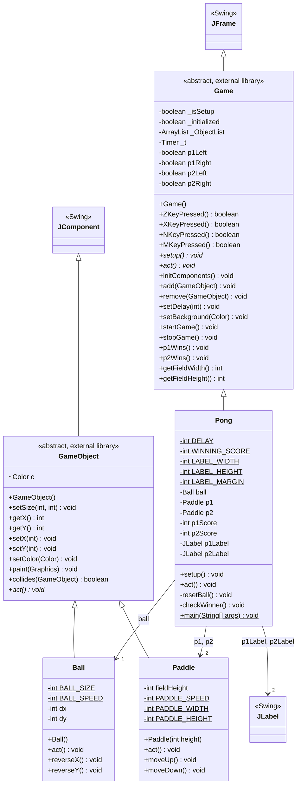

# Pong UML class diagram

`Game` and `GameObject` were inspected in `csta.ibm.pong.v15.jar`. `JFrame`, `JComponent`, and `JLabel` come from Swing. The `$` marker denotes a static member; `*` denotes an abstract method. Compiler-generated `access$` methods are omitted.
